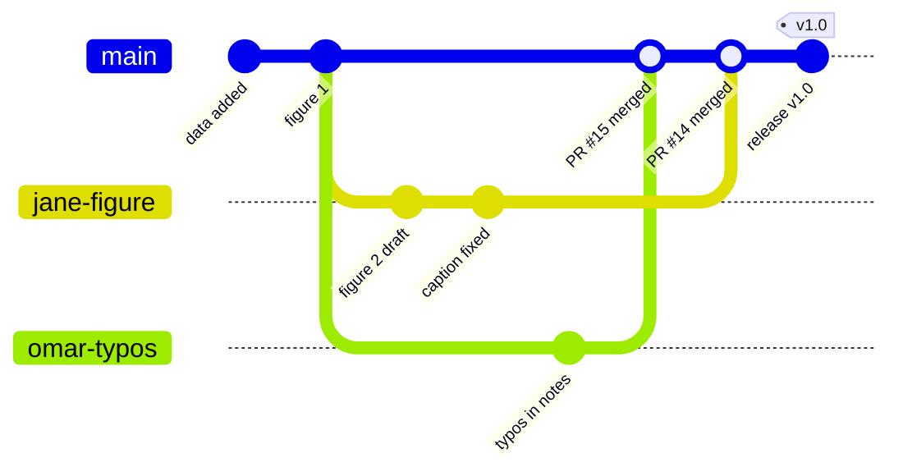
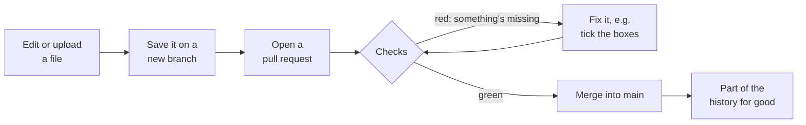

[← 0 Before the workshop](00-before-the-workshop.md) · **1 GitHub in five words** · [2 AI signoff →](02-ai-signoff.md)

# 1 · GitHub in five words

Five words are enough to work on GitHub. You already know the ideas behind them from shared folders and
"paper_final_v3_really_final.docx".

| Word | Think of it as | Here |
|---|---|---|
| **Repository** (repo) | A shared project folder that remembers every version of every file | This page lives in [one](https://github.com/industrial-mathematics-group/aisignoff-workshop) |
| **Commit** | One saved version, with a short note of what changed and who changed it | [The history of this repository](https://github.com/industrial-mathematics-group/aisignoff-workshop/commits/main) |
| **Branch** | Your own copy of the folder to work in, without disturbing anyone | `main` is the official version |
| **Pull request** (PR) | "Please take my changes into `main`": the change, a discussion, and automatic checks | [A merged one](https://github.com/industrial-mathematics-group/aisignoff-playground/pull/14) |
| **Merge** | The changes go into `main`; the pull request is closed | The green button |

Two more you'll meet: an **issue** is a note or a request ("this figure is wrong", "please record …"), and a
**release** is a named, frozen version of the whole repository, such as the one you publish with a paper.

## The picture

Everyone works on their own branch. A pull request brings one branch back into `main`.

## What happens to a change

The checks are little robots that run on every pull request. In the group's repositories they ask one
question: **did you say how this change was made and how you checked it?** That's AI signoff, part 2, and in
part 3 you install those checks yourself.

## Why bother?

- **Nothing is lost.** Every version of every file is kept, with who changed it, when and why.
- **Nobody overwrites anybody.** Everyone works on a branch; `main` changes only through pull requests.
- **Review happens in one place.** Comments, checks and the decision to merge sit next to the change.
- **It's citable.** A release can get a DOI from Zenodo (part 6), so the exact files behind a paper stay findable.

> It works the same for code, LaTeX, figures, CSV files and slides. GitHub shows the differences line by line
> for text files, and the old and the new version side by side for images. Other files, such as PDFs or Word
> documents, are kept and versioned just the same, but GitHub can't show what changed inside them.

---

[← 0 Before the workshop](00-before-the-workshop.md) · [2 AI signoff →](02-ai-signoff.md)
