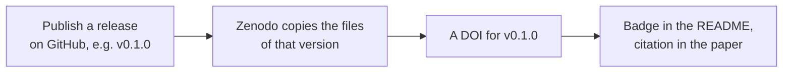

[← 5 The report on GitHub Pages](05-pages.md) · **6 Releases and DOIs** · [7 Advanced →](07-advanced.md)

# 6 · Releases and DOIs with Zenodo

[Zenodo](https://zenodo.org) is CERN's free research archive. Connected to GitHub, it archives **every
release** of a repository and gives it a **DOI**, so the exact files behind a paper can be cited and stay
findable even if the repository moves or disappears.

**Today we use the [Zenodo Sandbox](https://sandbox.zenodo.org)**: it works exactly like Zenodo but hands out
test DOIs. Real Zenodo records can't be deleted, so practise here.

## Step 1 · Connect Zenodo to your repository (5 min)

1. <https://sandbox.zenodo.org> → **Log in → Log in with GitHub.** On GitHub's page, if it lists
   **industrial-mathematics-group** under *Organization access*, click **Grant** (or **Request**) next to it.
2. On Zenodo: your account menu (top right) → **GitHub**.
3. **Sync now**, find `workshop-…` in the list and switch it **On**.

✅ **Check:** your repository shows as enabled on Zenodo's GitHub page.

## Step 2 · Add a citation file (5 min)

`CITATION.cff` says who the authors are and how to cite the files. GitHub then shows **Cite this repository**
in the sidebar, and Zenodo takes the title and authors from it.

1. Copy [`templates/CITATION.cff`](templates/CITATION.cff) from this workshop repository.
2. In your repository: **Add file → Create new file**, name `CITATION.cff`, paste, and put in **your** name
   (and your ORCID, if you have one).
3. Pull request as usual. Declare it: the template was written with Claude and you filled it in, so **G1**,
   **Claude Opus**, **H2**, **A0**. Merge.

Optional, the same way: [`templates/signoff-release.yml`](templates/signoff-release.yml) as
`.github/workflows/signoff-release.yml` attaches the aisignoff report to every release. Declare it as a copied
file keeps its origin: it comes from the aisignoff examples, made by Claude Opus and checked by GPT Sol in a new
session, which found nothing (aisignoff's own report says so). So: **G3**, **Claude Opus**, **A1** with
`GPT Sol (OpenAI)` after *Model, if not one of the above:*, `AI-Review-Findings: none`, and your human review
(**H0** if you only skimmed it, **H1** if you read the important parts).

✅ **Check:** the sidebar of your repository's front page shows **Cite this repository**.

## Step 3 · Publish a release (5 min)

1. Front page, right-hand side: **Releases → Create a new release** (or **Draft a new release**).
2. **Choose a tag** → type `v0.1.0` → **Create new tag: v0.1.0 on publish**.
3. Title: `First version`. Click **Generate release notes**: GitHub lists the merged pull requests.
4. **Publish release.**

A few minutes later Zenodo has archived it: Zenodo → account menu → **GitHub** shows the release and its DOI
(Sandbox DOIs start with `10.5072`). Click it for the record page.

| DOI | Points to | Use it for |
|---|---|---|
| **Version DOI** | exactly this release, `v0.1.0` | a paper: the files you actually used |
| **Concept DOI** | always the newest release | the README badge, "cite this work" |

✅ **Check:** the Zenodo record shows your files, your name from `CITATION.cff`, and a DOI.

## Step 4 · The badge (optional, 3 min)

On the Zenodo record, click the **DOI badge**, copy the **Markdown** and paste it at the top of your README in a
pull request. [aisignoff's README](https://github.com/industrial-mathematics-group/aisignoff) has a real one.

## Where AI signoff comes in

- `SIGNOFF.toml` is a file of the repository, so it is **archived with every release**.
- So is the review folder `reviews/`, with every AI review's report and record file.
- The declarations of single pull requests live in the git history, which Zenodo doesn't archive. aisignoff
  works out every line from that history each time (a cache keeps it fast); there is no snapshot file to take
  before a release any more. With `signoff-release.yml`, the release on GitHub carries the finished report, every
  line with its levels and findings, as files.

## For real

The same steps on <https://zenodo.org> give permanent DOIs. Only published releases are archived, never drafts
or ordinary merges. Add a licence before the first real release, and don't release anything you couldn't
publish: it stays public for good.

---

[← 5 The report on GitHub Pages](05-pages.md) · [7 Advanced →](07-advanced.md)
