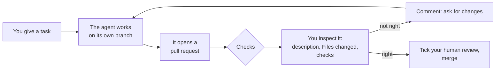

[← 6 Releases and DOIs](06-zenodo.md) · **7 Advanced**

# 7 · Advanced: working with AI agents

So far you made every change yourself, and IMGAgent wrote declarations for you. An AI agent goes further: it
changes the files of a repository on its own, from a task you give it. This part is a **demonstration**: watch,
ask questions, try it later.

The one thing to take away:

> **However an agent works, and wherever it runs, its work reaches your repository the same way: as a pull
> request that you inspect, declare and merge.** Everything from part 3 still applies.

## 7.1 · A basic agent workflow: Claude on the web

Pascal connects a Claude project on [claude.ai](https://claude.ai) to his GitHub repository and gives Claude a
task in plain words, for example:

> In `sample-project/paper/abstract.md`, add one sentence on the main limitation from the results summary.
> Open a pull request with the organisation's template, and tick the AI declaration for your part; leave the
> human review to me.

What you'll see:

1. **Claude works in a container in the cloud** with a copy of the repository: it reads the files, makes the
   change on a new branch, and may run things to check its work.
2. **It opens a pull request** with a description of what it did, and the AI declaration ticked for its own
   part (G3, its model), as the task asked. The human review boxes are left for the person responsible.
3. **Inspecting the pull request**, the same as for a colleague's:
   - **Conversation:** does the description match what you asked for?
   - **Files changed:** read the diff. Click **+** next to a line to comment on it. Tick **Viewed** on each file
     as you go.
   - **Checks:** PR-signoff stays red until you tick your human review; File-signoff checks the declarations.
   - Not right? **Comment** on the pull request or tell Claude in the project; it pushes a new commit to the
     same pull request, and the checks run again.
4. **Tick the human review you actually did**, and **merge**. You are responsible for it now: "the AI wrote it"
   is not a review.

**Claude on your computer:** the Claude desktop app works the same way, but runs on your own computer, with
your files and your tools. The result is still a branch and a pull request.

### Questions to ask yourself before you merge an agent's pull request

- Did it do **only** what I asked? (Agents like to "improve" things on the side: look at every file in
  *Files changed*.)
- Do the numbers, references and claims hold? Check the ones that matter against the source.
- Did it run what it says it ran? Its description is a claim, not a proof.
- Which human review did **I** do: H0 (looks right), H1 (I ran it, read the important parts), H2 (every line)?

## 7.2 · Showcase: an advanced setup

Pascal's own daily setup, as a demonstration only; how to build it is out of scope today. It looks very
different from 7.1, and ends in exactly the same place.

| Part | What it does |
|---|---|
| **Agent sandboxes** ([agent-sandbox](https://github.com/industrial-mathematics-group/agent-sandbox)) | Coding agents (Claude Code, Codex) run in locked-down containers. They may work without asking permission for every step, because they can't reach anything else: no access to the host, and network only to an allowlist of sites through a gateway |
| **GitHub as an App** | The agent pushes and opens pull requests as a bot account with short-lived tokens, never with someone's personal password. Its pull requests are recognisable as the bot's |
| **The university cluster** | The agent can submit jobs to the Slurm cluster through a gateway: only with capped resources, only its own jobs, each on a frozen snapshot of the code. It never gets a shell on the cluster |
| **Notifications** | The phone buzzes when the agent needs a decision or has finished |

A typical run: Pascal describes a study in an issue or a message, the agent writes the code in its sandbox, sends
the simulations to the cluster, collects the results, writes them up, and opens a pull request. Pascal reviews it
like any other: description, *Files changed*, checks, then his human review and the merge. The declaration says
what happened (here typically G3), and the report shows where his review has to be thorough.

| | Basic (7.1) | Advanced (7.2) |
|---|---|---|
| Where the agent runs | Anthropic's cloud, or your computer | A sandbox on a server; jobs on the cluster |
| How long it works | Minutes | Minutes to days |
| What it can reach | The repository | The repository, an allowlist of sites, capped cluster jobs |
| **What you get** | **A pull request** | **A pull request** |
| **What you do** | **Inspect, declare, merge** | **Inspect, declare, merge** |

---

[← 6 Releases and DOIs](06-zenodo.md) · [Overview](README.md)
